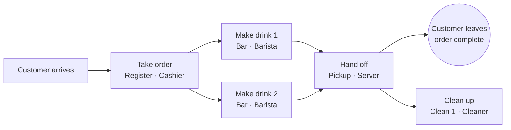

# SYNC demo scenario: the coffee shop

Status: agreed baseline scenario, 2026-10-23. Single source of truth for the demo domain.
Audience: every teammate and every coding agent working on SYNC (optimizer, database, UI).
If code or another doc disagrees with this file, this file wins until it is updated.

SYNC itself is a framework-independent multi-agent execution optimizer. The coffee
shop is only the demonstration domain: generic scheduling must not depend on it.

## 1. One-paragraph summary

Customers enter, queue, order at a register, wait while baristas make their drinks,
collect them from a server at pickup, and leave. After the customer has taken the
drink, a cleaner cleans up. Every order is a small **DAG of tasks**. Staff are agents
with a primary role; they work on fixed **slots**. Bigger and harder orders take
longer to take _and_ longer to make. SYNC decides who does which task, on which
slot, and when (or decides to wait). A baseline policy runs on the same customers for
comparison.

## 2. Floor: slots and zones

| Slot                   | Count | Used by (primary role) |
| ---------------------- | ----- | ---------------------- |
| Register 1, Register 2 | 2     | Cashier                |
| Bar 1, Bar 2           | 2     | Barista                |
| Pickup 1, Pickup 2     | 2     | Server                 |
| Clean 1                | 1     | Cleaner                |

- A slot holds one task at a time.
- Zones (for animation only): **Entrance → Line → Register → Waiting area → Pickup → Exit**.
- On screen there are no zone boxes. Customers and staff walk on invisible lanes with
  right-angle turns only (never diagonal).
- **Order line:** first come, first served, laid out like a theme-park queue with the tail
  always at the entrance: door → bottom row → U-turn → top row → head. A short line (up to 7)
  uses only the top row and shows no rope; newcomers walk the empty bottom lane to just behind
  the tail. A longer line continues on the bottom row behind a rope (about 20 people). When the
  head leaves, everyone walks one spot forward. Ordering starts only once the customer has
  walked up to the counter.
- **Pickup waiting is not a line:** orders can finish out of order (more or harder drinks
  take longer). Customers take the nearest free waiting spot and stay there; whoever's
  drinks are ready walks to pickup. Every spot touches an aisle, so nobody pushes past
  anyone; a customer waits a moment if someone is already walking in the aisle. More than
  10 waiting adds a sixth column (12); more than 12 adds rows and makes the board taller.
- There is no counter queue and no seating: an order ends when the server hands the
  drink to the customer.

## 3. Staff (agents)

| Role    | Headcount        | Primary task          |
| ------- | ---------------- | --------------------- |
| Cashier | 1–2 per scenario | Take order (Register) |
| Barista | 1–2 per scenario | Make drink (Bar)      |
| Server  | 1–2 per scenario | Hand off (Pickup)     |
| Cleaner | always 1         | Clean up (Clean)      |

- Headcount varies by scenario; the maximum equals the slot count. Same-role staff are
  told apart by name ("Cashier 1", "Cashier 2").
- **Helping (cross-role):** an agent may do another role's task when that helps. It is
  slower than the primary role (the mock uses ×1.25; the real factor is SYNC's to define).
  The UI labels such decisions "Helping".

## 4. Order = task DAG



- `take order → make drink(s) → hand off → clean up`. A task starts only when all its
  predecessors are finished.
- **Clean up starts only after the customer has taken the drink from the server**
  (after hand off). It does not count toward the customer's wait or the order's finish
  time, but it occupies the cleaner and Clean 1.
- An order with several drinks has one make task per drink; they may run in parallel
  on Bar 1 and Bar 2. Hand off waits for all of them. (Assumption, see §8.)
- The order's finish time `f_i` is the end of its hand off.

## 5. Order complexity drives durations

Orders differ in **how many items** they contain and **how hard** each item is.

| Effect               | Rule                                                          |
| -------------------- | ------------------------------------------------------------- |
| Take order (cashier) | Longer with more items and with harder items                  |
| Make drink (barista) | Longer for harder drinks; more drinks means more barista work |
| Hand off, clean up   | Roughly constant per order                                    |

Shape of the rule (coefficients belong to the SYNC team; the mock uses sample values):

```
order_time = order_base + order_per_item · items + Σ order_extra(item.complexity)
make_time(drink) = make_base(drink) · complexity_factor(drink.complexity)
```

Example menu (sample values only):

| Item                            | Complexity | Notes                                 |
| ------------------------------- | ---------- | ------------------------------------- |
| Tea, Americano                  | simple     | short to order, short to make         |
| Latte, Flat white, Cold brew    | medium     |                                       |
| Mocha, custom / seasonal drinks | complex    | long to order (options), long to make |

## 6. Decisions and objective

- Decision kinds: **Assign** (agent + slot + task) and **Wait** (hold a task for a
  better agent that frees up sooner, reserving the slot).
- Admission happens against a versioned snapshot with claims, so two decisions cannot
  take the same slot or agent.
- Objective (20): maximise orders finished within horizon T, minus penalties for late
  orders (P_deadline), execution cost (C_exec) and coordination cost (C_coord).
  `max Σ v_i·1{f_i ≤ T ∧ success} − β·P_deadline − γ·C_exec − δ·C_coord`, v_i = 1 by default.
- **Baseline vs SYNC:** both policies run on the same seed and the same customers.
  Baseline = first-come-first-served, primary role only. SYNC = the optimizer.
  Comparisons use paired seeds; simulated time is reported separately from wall-clock.

## 7. Out of scope

- Machine failures / resiliency (slots never break).
- Seating, tables, payment, inventory.
- Manual reassignment or editing objective weights from the UI.

## 8. Open questions

1. One make task per drink (parallel bars) or one per order? This doc assumes per drink.
2. May the cleaner help other roles, and may others clean?
3. Complexity coefficients, item counts per order, arrival pattern and deadline rule.
4. Helping slowdown factor per role pair.
5. Weights β, γ, δ and whether `planningMs` is used as C_coord.

## 9. Related

- UI contract: `contracts/INTERFACE.md` (in the UI workspace; Job/Task shapes there follow §4–§5).
- Dashboard (mock-backed): `apps/web/dashboard.html`, code under `apps/web/src/sync` and `apps/web/src/dashboard`.
